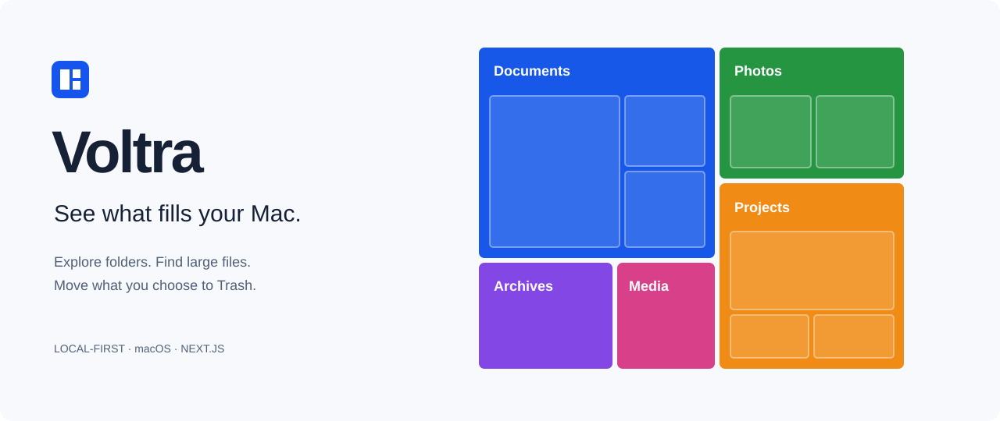

<p align="center"></p>

<p align="center">
  <a href="https://github.com/Braidner/voltra/actions/workflows/ci.yml"></a>
  <a href="LICENSE"></a>
  
  
</p>

<p align="center"><a href="#quick-start">Quick start</a> · <a href="#how-it-works">How it works</a> · <a href="#safety-and-privacy">Safety</a> · <a href="docs/README.ru.md">Русский</a> · <a href="CONTRIBUTING.md">Contributing</a></p>

Voltra turns your Mac's filesystem into an interactive treemap. Open folders, compare file types, and collect files for cleanup without leaving the browser. Selected items go through the native macOS Trash API.

The application runs locally. It reads filesystem metadata, not file contents, and does not upload your scan. The interface is currently in Russian. The cover above is an illustration, not a screenshot of a real disk.

## What you can do

- **Follow the directory tree.** Double-click a folder to open it; use breadcrumbs to go back. Deep branches load when opened.
- **Group by file type.** Find large files across the scanned tree, regardless of their folder.
- **Keep small files visible.** Readable tiles enlarge small segments. Exact-area mode restores proportional sizing; labels show measured sizes in both modes.
- **Review before cleanup.** Inspect an absolute path, add it to the cleanup tray, then confirm the exact selection.
- **Scan progressively.** Explore partial results, see access errors, or stop a running scan.

## Quick start

You need **macOS**, **Node.js 22+**, and **Xcode Command Line Tools** (for `swiftc`).

```sh
git clone https://github.com/Braidner/voltra.git
cd voltra
npm ci
npm run setup
npm run build
npm start
```

Open **[127.0.0.1:4391](http://127.0.0.1:4391)**, enter `/` or an absolute folder path, and click **Сканировать**. Use this exact host; the API rejects other Host headers.

For development, run `npm run dev` after setup. Both servers bind only to `127.0.0.1`.

## How it works

```text
Browser                     Local Next.js server             macOS
Treemap + inspector   →     Metadata scanner           →     Filesystem
Cleanup tray          →     Path / identity checks     →     Native Trash
```

The scanner walks directories without following symbolic links. It records allocated blocks, logical size, and file identity, then retains the largest entries for display. The browser polls progress every 1.8 seconds. No database or external service is required.

| Part | Implementation |
| --- | --- |
| Interface | Next.js, React, TypeScript, CSS |
| Scanner and local API | Node.js filesystem APIs |
| Treemap | Binary partitioning, with optional readable weights |
| Trash integration | A small Swift helper using Foundation |
| Tests | Node.js test runner through `tsx` |

## Safety and privacy

Cleanup is limited to content inside your home directory. The home root, `Library`, `.ssh`, `.gnupg`, `.codex`, Trash, the project itself, and its ancestors are protected. Other locations can be inspected.

The API checks the local Host, request Origin, session cookie, scan membership, and file identity. It rejects symbolic-link targets and selections containing both a folder and its descendants. The Swift helper checks identity again before moving an item.

**Moving an item to Trash does not free disk space.** Empty Trash yourself in macOS when you are ready. The app does not permanently delete files or automatically empty Trash. A new scan is required after cleanup.

Scan data lives in server memory and is lost when the server restarts. The application has no telemetry or remote fonts. Do not expose its local server through a public proxy or tunnel.

## Limits worth knowing

- **Access is permission-dependent.** Some folders require Full Disk Access for the application launching the server. System permissions are not changed automatically.
- **Allocated size is not a savings guarantee.** Hardlinks are counted once per scan. APFS clones, snapshots, and purgeable space can make totals differ from macOS storage figures.
- **The map is a bounded view.** It shows up to 36 main tiles and six nested tiles per folder. Lists show up to 80 entries; the scanner retains up to 160 children per directory and 80 large files per type.
- **Deep branches load on demand.** Branches beyond five levels are folded after counting. A depth guard at 80 levels marks exceptionally deep branches as partial.
- **The root view avoids duplicate APFS data.** `/System/Volumes` and selected virtual/network roots are skipped. A scan with inaccessible or skipped regions is partial.
- **This is an early release.** Windows and Linux Trash integration, persistent scan history, and a native app bundle are not implemented.

## Development

```sh
npm run setup     # Compile the native helper
npm test          # Scanner, navigation, sizing, and Trash regression tests
npm run check     # TypeScript
npm run build     # Production build
```

The native Trash test moves only a generated temporary fixture. It never targets existing personal files. CI runs on macOS to exercise the same native helper.

See [CONTRIBUTING.md](CONTRIBUTING.md) for contribution guidelines and [SECURITY.md](SECURITY.md) for reporting a security issue. Use synthetic data in screenshots and bug reports.

## License

[MIT](LICENSE) © 2026 Braidner.
